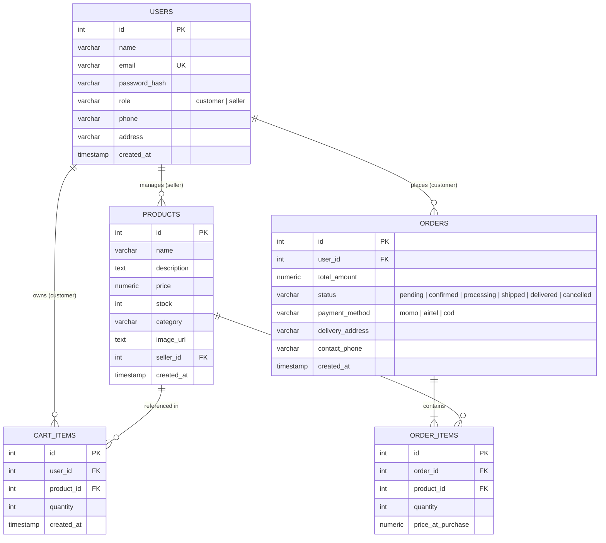

# D&G E-Commerce Platform — Technical Documentation

This document provides complete, in-depth architectural and technical specifications for the **D&G E-Commerce (DGShop)** mobile application developed for Rwamagana, Rwanda.

---

## 1. System Architecture

The D&G E-Commerce application is built as a universal full-stack mobile application using **Expo SDK 58** and **Expo Router v5**, integrated directly with a serverless **Neon PostgreSQL** database.

```mermaid
graph TD
    subgraph Client Application (Mobile / Web)
        UI[React Native / Expo UI]
        Router[Expo Router v5]
        Zustand[Zustand Stores: Auth, Products, Cart, Orders]
        AxiosClient[Axios Client + Offline NetInfo + JWT Interceptor]
        I18n[i18next: EN / FR / RW]
    end

    subgraph Server Runtime (Expo Server Routes)
        AuthAPI["/api/auth/*+api.ts"]
        ProductAPI["/api/products+api.ts"]
        CartAPI["/api/cart+api.ts"]
        OrderAPI["/api/orders+api.ts"]
        ServerAuth[src/server/auth.ts: JWT & bcryptjs]
    end

    subgraph Database Layer (Neon Serverless)
        NeonPool[Neon Postgres Connection Pool]
        UsersTable[(users)]
        ProductsTable[(products)]
        CartTable[(cart_items)]
        OrdersTable[(orders)]
        OrderItemsTable[(order_items)]
    end

    UI --> Router
    UI --> Zustand
    Zustand --> AxiosClient
    AxiosClient -->|HTTP/REST with Bearer Token| ServerRuntime
    AuthAPI --> ServerAuth
    ProductAPI --> ServerAuth
    CartAPI --> ServerAuth
    OrderAPI --> ServerAuth
    ServerRuntime --> NeonPool
    NeonPool --> UsersTable
    NeonPool --> ProductsTable
    NeonPool --> CartTable
    NeonPool --> OrdersTable
    NeonPool --> OrderItemsTable
```

---

## 2. Client-Server Architecture & Metro Separation

In React Native / Expo, running backend endpoints inside the same project requires strict isolation so that server-only Node.js libraries (`jsonwebtoken`, `bcryptjs`, `crypto`, `pg`) are **never** bundled into native client bundles (Hermes bytecode).

### Boundary Rules
1. **Server Routes**: Any file placed under `src/app/api/` ending in `+api.ts` is treated by Expo Router as a Node.js server route.
2. **Server Helpers**: Shared server code (such as `src/server/auth.ts`) must only be imported by `+api.ts` files and migration/test scripts.
3. **Client Services**: The client app under `src/app/(auth)`, `src/app/(customer)`, and `src/app/(seller)` exclusively interacts with the backend over HTTP via `src/api/client.ts`.

---

## 3. Database Schema & Relational Model

The database runs on **Neon PostgreSQL** with strict foreign keys, cascade deletes, and check constraints.



### Table Definitions & Constraints

1. **`users`**:
   - `id SERIAL PRIMARY KEY`
   - `email VARCHAR(255) UNIQUE NOT NULL`
   - `password_hash VARCHAR(255) NOT NULL`
   - `role VARCHAR(20) NOT NULL CHECK (role IN ('customer', 'seller'))`
   - `phone VARCHAR(20)`
   - `address TEXT`

2. **`products`**:
   - `id SERIAL PRIMARY KEY`
   - `seller_id INTEGER REFERENCES users(id) ON DELETE CASCADE`
   - `name VARCHAR(255) NOT NULL`
   - `price NUMERIC(12, 2) NOT NULL CHECK (price >= 0)`
   - `stock INTEGER NOT NULL DEFAULT 0 CHECK (stock >= 0)`
   - `category VARCHAR(50) NOT NULL`

3. **`cart_items`**:
   - `id SERIAL PRIMARY KEY`
   - `user_id INTEGER NOT NULL REFERENCES users(id) ON DELETE CASCADE`
   - `product_id INTEGER NOT NULL REFERENCES products(id) ON DELETE CASCADE`
   - `quantity INTEGER NOT NULL DEFAULT 1 CHECK (quantity > 0)`
   - `UNIQUE(user_id, product_id)`

4. **`orders`**:
   - `id SERIAL PRIMARY KEY`
   - `user_id INTEGER NOT NULL REFERENCES users(id) ON DELETE RESTRICT`
   - `total_amount NUMERIC(12, 2) NOT NULL CHECK (total_amount >= 0)`
   - `status VARCHAR(20) NOT NULL DEFAULT 'pending' CHECK (status IN ('pending', 'confirmed', 'processing', 'shipped', 'delivered', 'cancelled'))`
   - `payment_method VARCHAR(20) NOT NULL CHECK (payment_method IN ('momo', 'airtel', 'cod'))`
   - `delivery_address TEXT NOT NULL`
   - `contact_phone VARCHAR(20) NOT NULL`

5. **`order_items`**:
   - `id SERIAL PRIMARY KEY`
   - `order_id INTEGER NOT NULL REFERENCES orders(id) ON DELETE CASCADE`
   - `product_id INTEGER NOT NULL REFERENCES products(id) ON DELETE RESTRICT`
   - `quantity INTEGER NOT NULL CHECK (quantity > 0)`
   - `price_at_purchase NUMERIC(12, 2) NOT NULL CHECK (price_at_purchase >= 0)`

---

## 4. REST API Specification

All protected endpoints require an `Authorization: Bearer <jwt_token>` header.

### 4.1 Authentication Endpoints

#### `POST /api/auth/register`
- **Access**: Public
- **Request Body**:
  ```json
  {
    "name": "Jean Bosco",
    "email": "jean@example.rw",
    "password": "Password@123",
    "role": "customer",
    "phone": "+250788123456",
    "address": "Rwamagana Market, Stall 14"
  }
  ```
- **Responses**:
  - `201 Created`: Returns user object and JWT token.
  - `400 Bad Request`: Validation failure (e.g. invalid email or password too short).
  - `409 Conflict`: Email already exists.

#### `POST /api/auth/login`
- **Access**: Public
- **Request Body**:
  ```json
  {
    "email": "customer@dgshop.rw",
    "password": "Customer@123"
  }
  ```
- **Responses**:
  - `200 OK`: Returns authenticated user object and JWT token.
  - `401 Unauthorized`: Invalid credentials.

#### `POST /api/auth/forgot-password`
- **Access**: Public
- **Request Body**:
  ```json
  {
    "email": "customer@dgshop.rw"
  }
  ```
- **Responses**:
  - `200 OK`: Dispatch notification confirmed.

---

### 4.2 Products Endpoints

#### `GET /api/products`
- **Access**: Public / Authenticated
- **Query Parameters**:
  - `search` (string): Search term matched against `name` and `description` (case-insensitive `ILIKE`).
  - `category` (string): Filter by product category.
  - `id` (number): Fetch a single product's detail.
  - `seller_id` (number): Filter items belonging to a specific seller.
- **Responses**:
  - `200 OK`: Array of products or single product object.

#### `POST /api/products`
- **Access**: Protected (**Seller only**)
- **Request Body**:
  ```json
  {
    "name": "Kitenge Modern Shirt",
    "description": "Tailored Rwandan Kitenge cotton shirt",
    "price": 18000,
    "stock": 25,
    "category": "clothes",
    "image_url": "https://images.unsplash.com/photo-1596755094514-f87e34085b2c?w=600"
  }
  ```
- **Responses**:
  - `201 Created`: Created product object.
  - `403 Forbidden`: Authenticated user is not a seller.

#### `PUT /api/products`
- **Access**: Protected (**Seller only**)
- **Request Body**: Contains `id` plus updated fields (`name`, `description`, `price`, `stock`, `category`, `image_url`).
- **Responses**:
  - `200 OK`: Updated product object.
  - `404 Not Found`: Product does not exist or user is not the owning seller.

#### `DELETE /api/products`
- **Access**: Protected (**Seller only**)
- **Query Parameter**: `?id=<product_id>`
- **Logic**:
  - Checks if the product has associated `order_items`.
  - If ordered previously: sets `stock = 0` to preserve historical order records without breaking foreign key integrity.
  - If never ordered: performs a hard `DELETE` from database.
  - Automatically cleans active `cart_items` referencing this product.
- **Responses**:
  - `200 OK`: `{ "message": "Product deleted successfully" }`

---

### 4.3 Cart Endpoints

#### `GET /api/cart`
- **Access**: Protected (**Customer**)
- **Responses**:
  - `200 OK`: Returns cart items with joined product details (`name`, `price`, `stock`, `image_url`, `category`).

#### `POST /api/cart`
- **Access**: Protected (**Customer**)
- **Request Body**: `{ "product_id": 1, "quantity": 1 }`
- **Logic**: If the item already exists in the user's cart, increments quantity; checks available stock.
- **Responses**:
  - `201 Created` / `200 OK`: Updated cart list.

#### `PATCH /api/cart`
- **Access**: Protected (**Customer**)
- **Request Body**: `{ "item_id": 3, "quantity": 2 }`
- **Responses**:
  - `200 OK`: Updated cart list.

#### `DELETE /api/cart`
- **Access**: Protected (**Customer**)
- **Query Parameters**:
  - `?id=<cart_item_id>`: Removes specific item.
  - `?clearAll=true`: Empties the user's entire cart.
- **Responses**:
  - `200 OK`: Success status.

---

### 4.4 Orders Endpoints

#### `GET /api/orders`
- **Access**: Protected (**Customer or Seller**)
- **Logic**:
  - If `role === 'customer'`: Returns only orders placed by the user.
  - If `role === 'seller'`: Returns all orders with customer metadata (`customer_name`, `customer_email`, `customer_phone`).
- **Responses**:
  - `200 OK`: Array of orders with nested `items`.

#### `POST /api/orders`
- **Access**: Protected (**Customer**)
- **Request Body**:
  ```json
  {
    "delivery_address": "Rwamagana City Center, Near Bank of Kigali",
    "contact_phone": "+250788123456",
    "payment_method": "momo"
  }
  ```
- **Transaction Logic**:
  1. Validates cart has items and items have sufficient stock.
  2. Creates order record with total amount calculated from current product prices.
  3. Inserts all `order_items` snapshots.
  4. Decrements product stock count atomically.
  5. Clears customer's cart.
- **Responses**:
  - `201 Created`: Created order object with items.
  - `400 Bad Request`: Empty cart or insufficient stock.

#### `PATCH /api/orders`
- **Access**: Protected (**Seller only**)
- **Request Body**:
  ```json
  {
    "order_id": 12,
    "status": "shipped"
  }
  ```
- **Valid Status Values**: `'pending'`, `'confirmed'`, `'processing'`, `'shipped'`, `'delivered'`, `'cancelled'`.
- **Responses**:
  - `200 OK`: Updated order object.

---

## 5. Security & Authentication Architecture

1. **Password Hashing**: Passwords are hashed using `bcryptjs` with salt round `10`. Plaintext passwords are never stored or logged.
2. **JWT Session Management**: Tokens are signed using `HS256` with expiration set to 7 days (`7d`).
3. **Payload Structure**:
   ```json
   {
     "sub": 1,
     "email": "seller@dgshop.rw",
     "role": "seller",
     "iat": 1740000000,
     "exp": 1740604800
   }
   ```
4. **Token Storage**:
   - Native: `expo-secure-store` encrypts the JWT in hardware-backed keychain/keystore.
   - Web fallback: `localStorage`.
5. **Axios Token Interceptor**: Automatically attaches `Authorization: Bearer <token>` to all outbound requests and handles `401 Unauthorized` responses by calling `logout()`.

---

## 6. Internationalization (i18n)

The app supports dynamic runtime language switching across 3 languages:
- **English (`en`)**: Default international language.
- **French (`fr`)**: Widely spoken administrative language in Rwanda.
- **Kinyarwanda (`rw`)**: Mother tongue of Rwanda and primary language in Rwamagana.

### Translation Namespace Structure
Key namespaces cover:
- `auth`: Login, registration, role selection, validation messages.
- `common`: Navigation tabs, buttons, currency formatting (`RWF`).
- `catalog`: Categories, search, filter, stock badges.
- `cart`: Subtotal, delivery fee, checkout action.
- `checkout`: Payment method labels, phone validation hints, address fields.
- `orders`: Tracking statuses (Itegerezwa, Yemejwe, Yatangiye gukorwa, Yagejejwe mu nzira, Yageze ku mukiriya, Yahagaritswe).
- `seller`: Inventory management, stock alerts, sales analytics.

---

## 7. State Management Architecture

Zustand stores handle client state with zero boilerplate:

| Store | File | Key Responsibilities |
| :--- | :--- | :--- |
| **`authStore`** | `src/store/authStore.ts` | User session, login, register, token restoration, logout |
| **`productStore`** | `src/store/productStore.ts` | Product list, category filtering, search queries, active product detail |
| **`cartStore`** | `src/store/cartStore.ts` | Cart items, total item count badge, subtotal calculations, checkout clear |
| **`orderStore`** | `src/store/orderStore.ts` | Customer order list, tracking timelines, seller orders, status updates |

---

## 8. Network Resilience & Offline Detection

The app integrates `@react-native-community/netinfo` inside `src/api/client.ts`. Before every network request:
1. Client inspects current internet reachability.
2. If offline, the request fails fast with an explanatory alert (`OfflineError`) rather than hanging until timeout.
3. Once back online, the app seamlessly resumes state fetching.
